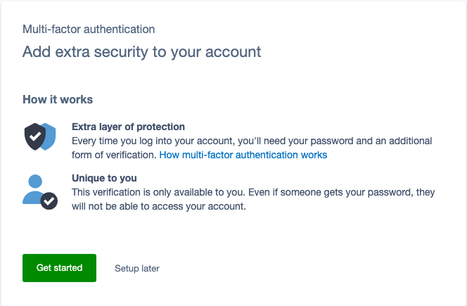
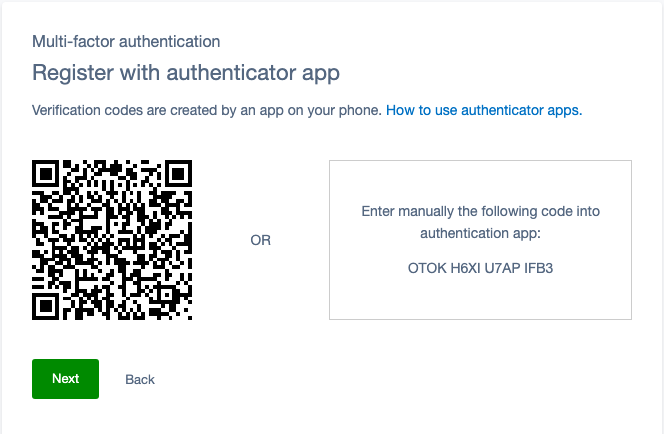
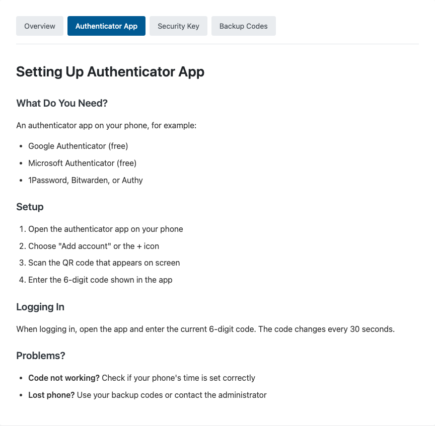

# Silverstripe MFA bundle

Multi-factor authentication for the Silverstripe CMS in one install: every CMS user sets up an
authenticator app (TOTP) or a security key, Touch ID, Windows Hello or passkey (WebAuthn), with a
grace period to do it in. Administrators can reset one member's MFA, and your users get help pages
in their own language. For Silverstripe 5 and 6.



*Maintained by [Restruct](https://github.com/restruct). If this module saves you time, you can
[support ongoing maintenance](https://github.com/sponsors/restruct).*

## Upstream MFA is a framework, not a finished setup

`silverstripe/mfa` provides the multi-factor login flow, but on its own MFA stays optional and it
brings no authenticator method of its own: you install the methods yourself, set a secret key,
switch on "MFA required" in Settings and choose a grace period. The security key method then
accepts external keys only (USB/NFC), so Touch ID, Windows Hello and other built-in authenticators
are not offered. The help links point your editors to
Silverstripe's user guide, and to reset one member's authenticator an administrator has only the
account reset email, which resets their password as well. A few upstream defects get in the way
too: a site title that is empty or contains a colon makes authenticator-app registration fail with
a 500, and every wrong password counts twice towards the account lockout.

## One install: MFA required, two methods, tools for administrators

- **MFA required for every CMS user** from the first `dev/build`, with a 6-month grace period in
  which they can choose "Setup later" ([section 4](#4-mfa-requirement-enabled-by-default)).
- **Two methods to choose from**: an authenticator app (TOTP: Google Authenticator, 1Password,
  Authy and the like) and a security key or the device's own biometrics (WebAuthn: USB/NFC keys,
  Touch ID, Face ID, Windows Hello, passkeys), plus upstream's recovery codes. It bundles
  `silverstripe/mfa`, `silverstripe/totp-authenticator` and `silverstripe/webauthn-authenticator`.
- **Authenticator-app settings that hold**: issuer name, period and algorithm are configurable, and
  period and algorithm are used to check the code, not only to build the QR code. Tokens registered
  on a dev or test site are labelled `(DEV)` or `(TEST)`. An empty site title, or one with a colon,
  no longer breaks registration ([section 2](#2-configure-totp-settings-optional)).
- **Password reset cannot skip MFA** (CVE-2026-55186). On CMS 5, upstream asks for the second factor
  only when the change password form is shown, so posting the form directly changed the password
  and logged the member in without it; upstream disclosed this without a fix for CMS 5. The bundle
  requires a completed MFA check, made for that same member, before a reset is accepted. Projects
  that run `composer audit` can ignore `PKSA-xxk3-rjxm-jftv` with that reason once this release is
  installed.
- **A "Registered MFA Methods" list on each member**, so an administrator can delete a method and
  have that member register again.
- **Help pages** at `/mfa-help/` in five languages, linked from the login screens.
- **Optional: each login attempt counted once** instead of twice
  ([section 6](#6-count-each-login-attempt-once-optional-opt-in)).

### Members register an authenticator app or a security key



The screenshot is from a throwaway test host: the secret shown belongs to a test account that no
longer exists.

**Authenticator app (TOTP)**
1. A secret is generated and encrypted with `SS_MFA_SECRET_KEY`
2. The QR code shows your configured issuer name, with the environment label on dev and test sites (e.g. `My Site (DEV)`)
3. User scans with Google Authenticator, Authy, 1Password, etc.
4. On login, user enters the 6-digit code from their app

**Security key or biometrics (WebAuthn)**
1. User registers their authenticator (USB key, Touch ID, etc.)
2. A credential is stored, tied to your domain
3. On login, user taps their key or uses biometrics

**Note:** WebAuthn credentials are domain-specific. Not recommended with `silverstripe/subsites` as each subsite domain would need separate credentials.

### Administrators can reset one member's MFA


Admins with the `MFA_ADMINISTER_REGISTERED_METHODS` permission can manage MFA for other users:

1. Go to **Security > Users** and edit a user
2. Find the **Registered MFA Methods** GridField, directly below the user's MFA settings (only shown for users with MFA configured)
3. Delete any MFA methods to force the user to re-register

When all MFA methods are removed, the user will be prompted to set up MFA again on their next login.

**Note:** This GridField only appears when viewing other users' accounts, not your own (use the standard MFA interface for self-management).

#### Alternative: Account Reset Email

SilverStripe MFA also includes a built-in "Send account reset email" button that sends the user a link to reset both their password and MFA settings. This is useful when you want the user to verify their identity via email.

### Help pages for your users



This bundle includes translatable help pages served at `/mfa-help/`:

| URL | Content |
|-----|---------|
| `/mfa-help/` | Overview of MFA |
| `/mfa-help/totp` | Authenticator app setup |
| `/mfa-help/webauthn` | Security key / biometrics setup |
| `/mfa-help/backup-codes` | Backup codes explanation |

Help pages automatically display in the logged-in user's CMS locale (from `Member.Locale`), falling back to the site's default locale. Translations are included for: English, Dutch, German, French, and Spanish.

The login screens link to these pages: the bundle sets `user_help_link` on the MFA handlers (see
[Help link settings](#help-link-settings-set-by-this-bundle)).

#### Disabling Help Pages

To disable the built-in help pages entirely, set `DISABLE_MFA_HELP` as an environment variable:

```env
# .env
DISABLE_MFA_HELP=1
```

A `define('DISABLE_MFA_HELP', true)` in `app/_config.php` does not work: the route is decided when
the configuration is built, before `_config.php` files run, so the pages keep answering.

The login screens still link to `/mfa-help/` after that: point the help links elsewhere, or set
them to empty strings (see [Customizing Help Content](#customizing-help-content)).

#### Changing the URL Segment

To serve help pages at a different URL (e.g., `/hulp/`):

1. Disable the default route via `DISABLE_MFA_HELP`
2. Configure your custom URL segment and Director rule:

```yaml
# app/_config/mfa-help.yml
Restruct\MFABundle\Controllers\MFAHelpController:
  url_segment: 'hulp'

SilverStripe\Control\Director:
  rules:
    'hulp': 'Restruct\MFABundle\Controllers\MFAHelpController'
```

3. Update the help URLs to match your custom segment:

```yaml
SilverStripe\TOTP\RegisterHandler:
  user_help_link: '/hulp/totp'

SilverStripe\WebAuthn\RegisterHandler:
  user_help_link: '/hulp/webauthn'

SilverStripe\MFA\Authenticator\LoginHandler:
  user_help_link: '/hulp/'

SilverStripe\MFA\BackupCode\RegisterHandler:
  user_help_link: '/hulp/backup-codes'
```

#### Customizing Help Content

Override the translations via lang files in your project, or point to your own URLs:

```yaml
SilverStripe\TOTP\RegisterHandler:
  user_help_link: 'https://your-site.com/help/totp'

SilverStripe\WebAuthn\RegisterHandler:
  user_help_link: 'https://your-site.com/help/security-keys'

SilverStripe\MFA\Authenticator\LoginHandler:
  user_help_link: 'https://your-site.com/help/mfa'

SilverStripe\MFA\BackupCode\RegisterHandler:
  user_help_link: 'https://your-site.com/help/backup-codes'
```

To disable help links entirely, set them to empty strings.

### Touch ID, security key or passkey: WebAuthn authenticator types

WebAuthn supports different authenticator types with different trade-offs:

#### Platform vs Cross-Platform

| Type | Examples | Pros | Cons |
|------|----------|------|------|
| **Platform** | Touch ID, Face ID, Windows Hello | Free, built-in, convenient | Tied to single device |
| **Cross-platform** | YubiKey, USB/NFC security keys | Portable, works anywhere | Requires purchasing hardware |

#### Passkeys (Synced Credentials)

Modern browsers support **passkeys**: WebAuthn credentials that sync across devices:

- **iCloud Keychain**: Syncs across Apple devices (Mac, iPhone, iPad)
- **Google Password Manager**: Syncs across Chrome browsers logged into same Google account
- **Password managers**: 1Password, Bitwarden, Proton Pass can store passkeys

When a user registers WebAuthn with `authenticator_attachment: ~` (both), the browser offers choices:
1. **This device** (platform): Touch ID/Face ID, may sync via iCloud/Google
2. **Security key** (cross-platform): USB/NFC hardware key
3. **Phone/tablet**: Use another device via QR code

Users can register multiple authenticators for redundancy.

#### Recommendation

This bundle defaults to `authenticator_attachment: ~` (allow both) for maximum flexibility. Users can choose based on their needs:
- Office workers with one machine -> Touch ID
- Mobile workers -> Synced passkey or hardware key
- High-security environments -> Hardware keys only (`'cross-platform'`)

## Requirements

- Silverstripe 5.4 or newer, or 6
- PHP 8.1 or newer (Silverstripe 6 itself requires PHP 8.3)
- `ext-bcmath` PHP extension (required by WebAuthn)
- HTTPS for the security key (WebAuthn) method: on plain HTTP upstream shows it as unsupported

## Version compatibility

| Branch | Module version | Silverstripe | PHP |
|--------|----------------|--------------|-----|
| `main` | `1.5.0` and later | `^5.4 \|\| ^6` | `^8.1` |
| (tags only) | `0.1` - `1.4.x` | `^5` | `^8.1` |

`main` is the only maintained line: it supports every Silverstripe version this module targets, so
there is no separate maintenance branch. Silverstripe 4 is not supported.

**`composer.json` is the source of truth** for exact constraints; this table is a quick reference.

## Installation

```bash
composer require restruct/silverstripe-mfa-bundle
```

Then add `SS_MFA_SECRET_KEY` to `.env` ([section 1](#1-set-encryption-key-required)) and run
`dev/build`. That's it. MFA is enforced with a 6-month grace period out of the box.

## Configuration

### 1. Set encryption key (required)

Add to your `.env`:

```env
SS_MFA_SECRET_KEY="your-secure-random-key-here"
```

Generate a key:

```bash
php -r "echo bin2hex(random_bytes(32));"
```

### 2. Configure TOTP settings (optional)

Create `app/_config/mfa.yml`:

```yaml
# Settings via this bundle's extension
Restruct\MFABundle\Extensions\TOTPConfigExtension:
  issuer: 'My Company CMS'      # Name shown in authenticator apps
  period: 30                     # Seconds per code (default: 30)
  algorithm: 'sha1'              # sha1, sha256, sha512 (default: sha1)
  environment_label: ~           # null = automatic (see below), a string = always, false = never
  environment_label_format: '%s (%s)'  # sprintf: issuer, label

# Settings on SilverStripe's TOTP classes (set directly)
SilverStripe\TOTP\Method:
  code_length: 6                 # Digits per code, 6 to 8 (default: 6; see below)

SilverStripe\TOTP\RegisterHandler:
  secret_length: 16              # Length of generated secret (default: 16)
  user_help_link: 'https://example.com/mfa-help'  # Help link during setup
```

`period`, `algorithm` and `code_length` apply to new registrations: they go into the QR code, the
code is checked with them, and they are stored with the registration. A login is always checked
with the settings the member registered with (the login field also asks for the number of digits
the member registered with), so changing them later does not lock anyone out; members who should
move to the new settings register their app again. Registrations made before 1.8.0 keep 30 s /
SHA1, and registrations made before 1.9.0 keep 6 digits, which is what they were checked with.
Upstream applies `code_length` to the input field only, so without the bundle a value other than 6
accepts no code at all ([#7](https://github.com/restruct/silverstripe-mfa-bundle/issues/7)). Not
every authenticator app honours a non-default period, algorithm or number of digits; one that
ignores them cannot register.

To do this the bundle replaces `SilverStripe\TOTP\RegisterHandler` and `VerifyHandler` with
subclasses through the Injector (upstream has no hook where the code is checked). A project that
replaces those handlers itself should extend `Restruct\MFABundle\TOTP\RegisterHandler` /
`VerifyHandler` instead. Replace both or neither: a `VerifyHandler` that does not extend the
bundle's checks every login with 30 s / SHA1 / 6 digits and would lock out members registered with
other settings, so with a non-default period, algorithm or `code_length` the bundle then refuses the
registration (the member is asked to contact an administrator, and an error is logged).

**Rollback:** with a non-default `period` or `algorithm`, going back to 1.7.0 or earlier, or
removing the bundle, locks out every member registered with those settings: logins are then checked
with 30 s / SHA1 again. Likewise, with a `code_length` other than 6, going back to 1.8.0 or earlier,
or removing the bundle, locks out every member registered with that number of digits. Those members
have to register their app again (an administrator can reset their MFA).

#### Issuer

The issuer (the name most authenticator apps show) is the `issuer` config, else the SiteConfig
title, else `LeftAndMain.application_name`. Colons (`:` and `%3A`) are removed from each of them,
because the issuer is written into the otpauth URI as `issuer:account` and the TOTP library refuses
a colon. Without this, upstream `silverstripe/totp-authenticator` fails the registration with a 500
when the site title is empty or contains a colon (upstream issues #64 and #106): the bundle's
`RegisterHandler` builds the issuer safely in those two cases and leaves every other registration
to upstream unchanged. If no issuer is left at all, the token is registered without one.

#### Environment label on the issuer

So a token registered on a dev or test site is not mistaken for the live one, the bundle adds the
environment to the issuer (the title most authenticator apps show): `My Site (DEV)`,
`My Site (TEST)`. On live, and on any other environment type, nothing is added.

- `environment_label: ~` (default): automatic. Environment type `dev` gives `DEV`, `test` gives
  `TEST`. Anything else gets no label: `live`, and also an unexpected `SS_ENVIRONMENT_TYPE` value
  such as `Live` or `staging` (use a string label for those).
- `environment_label: 'STAGING'`: always use this string, whatever the environment type, live
  included (e.g. a staging site that runs as `live`).
- `environment_label: false`: never add a label.
- `SS_MFA_TOTP_ENVIRONMENT_LABEL` in `.env` wins over the config when it is set. Set it to a string
  to use that label. Leave it empty (`SS_MFA_TOTP_ENVIRONMENT_LABEL=` or
  `SS_MFA_TOTP_ENVIRONMENT_LABEL=""`) or set it to `false` to switch the label off. When the
  variable is not there at all, the config applies. Use `false` to switch it off: the `.env` parser
  reads `0`, `1` and `off` as text, so those become the label.
- `environment_label_format` is a `sprintf()` format with the issuer as the first argument and the
  label as the second. The default is `'%s (%s)'`; `'[%2$s] %1$s'` gives `[DEV] My Site`. A format
  that cannot be rendered, or that leaves the label out (`'%s'`), falls back to the default.

The label is added after the issuer is resolved (`issuer` config, then the SiteConfig title, then
`LeftAndMain.application_name`). If the issuer already carries the label (`issuer: 'My Site (DEV)'`,
or `'[DEV] My Site'` with a prefix format) it is not added a second time. Colons are
removed from the label and the result, because the issuer is written into the otpauth URI as
`issuer:account` and a colon would make registration fail.

Two things to know:

- **The label is baked into the token when it is registered.** The authenticator app stores the
  issuer it was given, so changing the config later does not rename existing tokens. To change the
  label on a token, remove it in the app and register the authenticator again.
- **A live database copied to a test site carries live's tokens, without the label.** They are the
  same secrets, so the codes keep working on the test site; the app simply shows them under the
  live name. Members who register again on the test site get a separate, labelled token.

### 3. Configure WebAuthn settings (optional)

By default, this bundle allows both platform authenticators (Touch ID, Windows Hello, Face ID) and cross-platform authenticators (USB security keys). You can restrict this:

```yaml
SilverStripe\WebAuthn\RegisterHandler:
  # null = both types (default set by this bundle)
  # 'platform' = biometrics only (Touch ID, Windows Hello)
  # 'cross-platform' = security keys only (SilverStripe default)
  authenticator_attachment: ~

  # Custom help link shown during setup
  user_help_link: 'https://example.com/webauthn-help'
```

**Note:** WebAuthn requires HTTPS and a supported browser (Chrome, Firefox, Safari, Edge).


### 4. MFA requirement (enabled by default)

This bundle enables "MFA Required" on every `dev/build`, including the very first one on an empty database, and hides the SiteConfig MFA settings (Settings > Access). Users will be prompted to set up MFA on their next login.

A **grace period of 6 months** is set by default, allowing users to skip MFA setup temporarily. After the grace period expires, MFA becomes mandatory.

```yaml
# Customize grace period (default: 180 days = 6 months)
Restruct\MFABundle\Extensions\SiteConfigMFAExtension:
  grace_period_days: 90   # 3 months
  # grace_period_days: 0  # No grace period - MFA required immediately
```

To show the MFA settings in SiteConfig:

```yaml
Restruct\MFABundle\Extensions\SiteConfigMFAExtension:
  show_mfa_settings: true
```

With the fields shown, "MFA Required" is the administrator's setting. `dev/build` switches it on
only when it creates the SiteConfig record, which is the first build of a fresh database; after
that, a build leaves it as it is, so an administrator who turns it off in Settings > Access keeps it
off. Adding the bundle to an existing site with `show_mfa_settings: true` therefore does not turn
MFA on: switch it on in Settings > Access. The grace period follows the same rule: `dev/build`
fills in an empty grace-period date only on a fresh database, so a date the administrator cleared
stays cleared. In either mode a grace-period date that is already set is never overwritten.

### 5. Disable during development (optional)

Add to `.env`:

```env
BYPASS_MFA=1
```

### 6. Count each login attempt once (optional, opt-in)

`silverstripe/mfa` checks the password twice on every login form submit that does not continue to
the MFA step: a wrong password, or a member who does not need MFA. Each check records a
`LoginAttempt`. So one wrong password counts as two failed attempts, and an account locks after 5
wrong passwords instead of the 10 set in `Member.lock_out_after_incorrect_logins`. A valid login
without MFA is also recorded twice. Upstream issue:
[silverstripe/silverstripe-mfa#421](https://github.com/silverstripe/silverstripe-mfa/issues/421).

This bundle ships a login handler that checks once per submit. It is off by default. Enable it in
your project's YAML:

```yaml
SilverStripe\Core\Injector\Injector:
  SilverStripe\MFA\Authenticator\LoginHandler:
    class: Restruct\MFABundle\Authenticator\SingleCheckLoginHandler
```

The handler only keeps the result of the first check and gives it to the second. The rest of the
login runs through the MFA and framework code unchanged, with the same extension hooks. Once you
enable it, the lockout follows `lock_out_after_incorrect_logins` again. If you doubled that value to
compensate, set it back.

## Configuration Reference

### Bundle settings

| Class | Setting | Default | Description |
|-------|---------|---------|-------------|
| `SiteConfigMFAExtension` | `grace_period_days` | 180 | Days users can skip MFA (0 = no grace period) |
| `SiteConfigMFAExtension` | `show_mfa_settings` | false | Show MFA fields in SiteConfig |
| `TOTPConfigExtension` | `issuer` | SiteConfig Title | App name shown in authenticator |
| `TOTPConfigExtension` | `period` | 30 | Seconds per code |
| `TOTPConfigExtension` | `algorithm` | sha1 | Hash algorithm (sha1/sha256/sha512) |
| `TOTPConfigExtension` | `environment_label` | null (automatic) | Label added to the issuer: null = `DEV`/`TEST` on dev/test only, string = always, false = never. Overridden by `SS_MFA_TOTP_ENVIRONMENT_LABEL` (empty or `false` = off) |
| `TOTPConfigExtension` | `environment_label_format` | `'%s (%s)'` | `sprintf()` format: issuer, label |

### SilverStripe TOTP settings (set directly on SS classes)

| Setting | Class | Default | Description |
|---------|-------|---------|-------------|
| `code_length` | `Method` | 6 | Digits per code (6 to 8): QR code, check and input field. Stored per registration, so a change applies to new registrations only (since 1.9.0, [#7](https://github.com/restruct/silverstripe-mfa-bundle/issues/7)) |
| `secret_length` | `RegisterHandler` | 16 | Secret key length |

### SilverStripe WebAuthn settings (set directly on SS classes)

| Setting | Class | Default | Description |
|---------|-------|---------|-------------|
| `authenticator_attachment` | `RegisterHandler` | `null`* | Allowed authenticator types |

*This bundle sets the default to `null` (allow both). SilverStripe's default is `cross-platform` (security keys only).

### Help link settings (set by this bundle)

| Class | Setting | Default |
|-------|---------|---------|
| `SilverStripe\TOTP\RegisterHandler` | `user_help_link` | `/mfa-help/totp` |
| `SilverStripe\WebAuthn\RegisterHandler` | `user_help_link` | `/mfa-help/webauthn` |
| `SilverStripe\MFA\Authenticator\LoginHandler` | `user_help_link` | `/mfa-help/` |
| `SilverStripe\MFA\BackupCode\RegisterHandler` | `user_help_link` | `/mfa-help/backup-codes` |

Override these if you use a custom URL segment or external help pages.

**Authenticator attachment options:**
- `~` or `null`: Both platform and cross-platform (recommended)
- `'platform'`: Only biometrics (Touch ID, Windows Hello, Face ID)
- `'cross-platform'`: Only USB/NFC security keys

### MFA enforcement

| Setting | Class | Default | Description |
|---------|-------|---------|-------------|
| `required_mfa_methods` | `EnforcementManager` | 1 | Minimum methods required |

## Troubleshooting

### "This method has not been configured yet"

The `SS_MFA_SECRET_KEY` environment variable is not set.

### WebAuthn "Security key" option not showing

- Ensure you're using HTTPS (required by WebAuthn)
- Check browser support (Chrome, Firefox, Safari, Edge)
- Verify `authenticator_attachment` isn't set to `'cross-platform'` if you want biometrics

### WebAuthn not working with Touch ID / Windows Hello

The default SilverStripe setting only allows USB security keys. This bundle changes it to allow both, but if you've overridden `authenticator_attachment`, ensure it's set to `~` (null) or `'platform'`.

### Testing locally

Use `BYPASS_MFA=1` in `.env` to skip MFA during development.

**Note:** WebAuthn passkeys require a trusted HTTPS certificate. Self-signed certificates may cause registration to fail with Chrome's native passkey storage.

## Running the tests

The suite needs a booted Silverstripe project. Require the module into a Silverstripe 5 or 6 project
through a **path repository with `"symlink": true`** (`/tests` is `export-ignore`, so a Packagist or
mirrored install contains no tests), add `silverstripe/recipe-testing`, map the
`Restruct\MFABundle\Tests\` namespace to `vendor/restruct/silverstripe-mfa-bundle/tests/` in
`autoload-dev`, then flush the test manifest as the runner requires:

```bash
# Silverstripe 5 (PHPUnit 9): the path first, then flush=1
vendor/bin/phpunit --fail-on-empty-test-suite vendor/restruct/silverstripe-mfa-bundle/tests flush=1

# Silverstripe 6 (PHPUnit 11): a bare flush=1 is read as a test path, use the environment variable
SS_PHPUNIT_FLUSH=1 vendor/bin/phpunit --fail-on-empty-test-suite \
    vendor/restruct/silverstripe-mfa-bundle/tests
```

`.github/workflows/ci.yml` builds exactly such a host for each supported major.

Browser tests (Playwright) live in `tests/browser/`. The screenshots in this README are generated
from a test host by `tests/browser/screenshots/readme.shot.ts`; see the README in that directory.

## Further Reading

### SilverStripe Documentation
- [MFA Module](https://github.com/silverstripe/silverstripe-mfa) - Core MFA framework
- [TOTP Authenticator](https://github.com/silverstripe/silverstripe-totp-authenticator/blob/6/docs/en/index.md) - Authenticator app configuration
- [WebAuthn Authenticator](https://github.com/silverstripe/silverstripe-webauthn-authenticator/blob/master/docs/en/readme.md) - Security keys configuration

### WebAuthn Specifications
- [WebAuthn Guide](https://webauthn.guide/) - Introduction to WebAuthn
- [Authenticator Selection Criteria](https://github.com/web-auth/webauthn-framework/blob/1.2.x/doc/webauthn/PublicKeyCredentialCreation.md#authenticator-selection-criteria) - Technical details on authenticator filtering

## License

MIT
